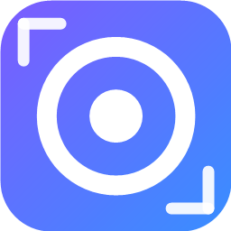
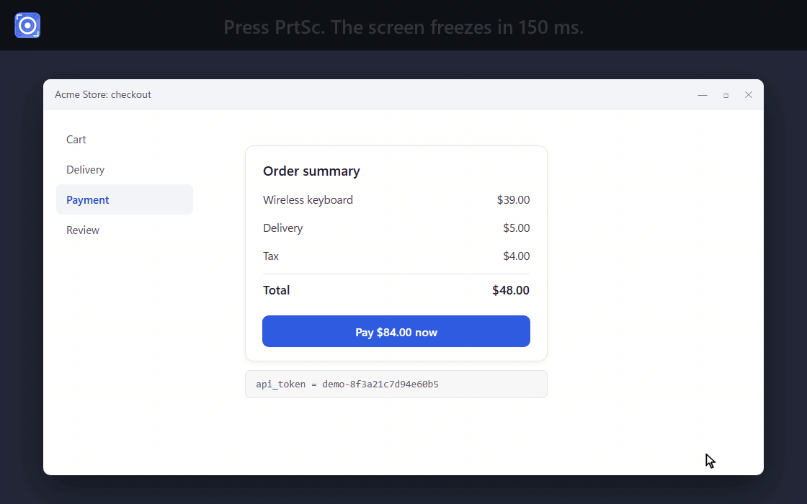
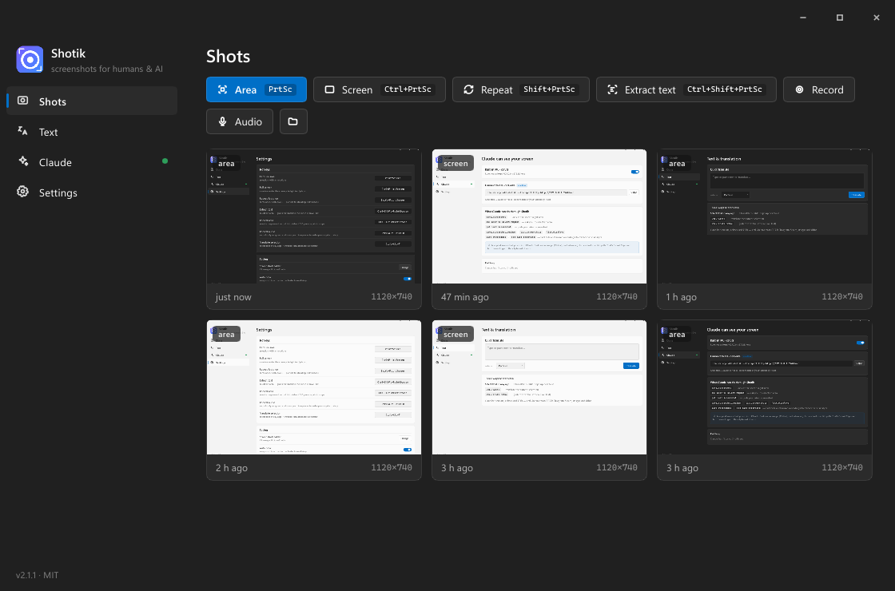
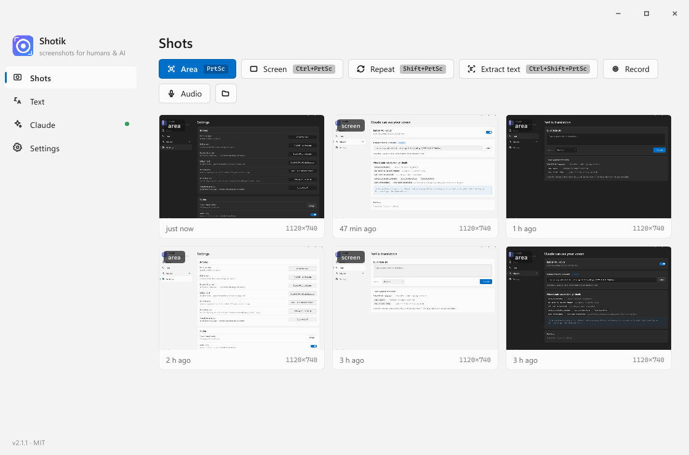
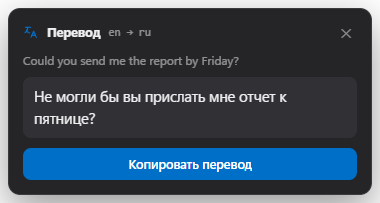
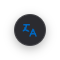
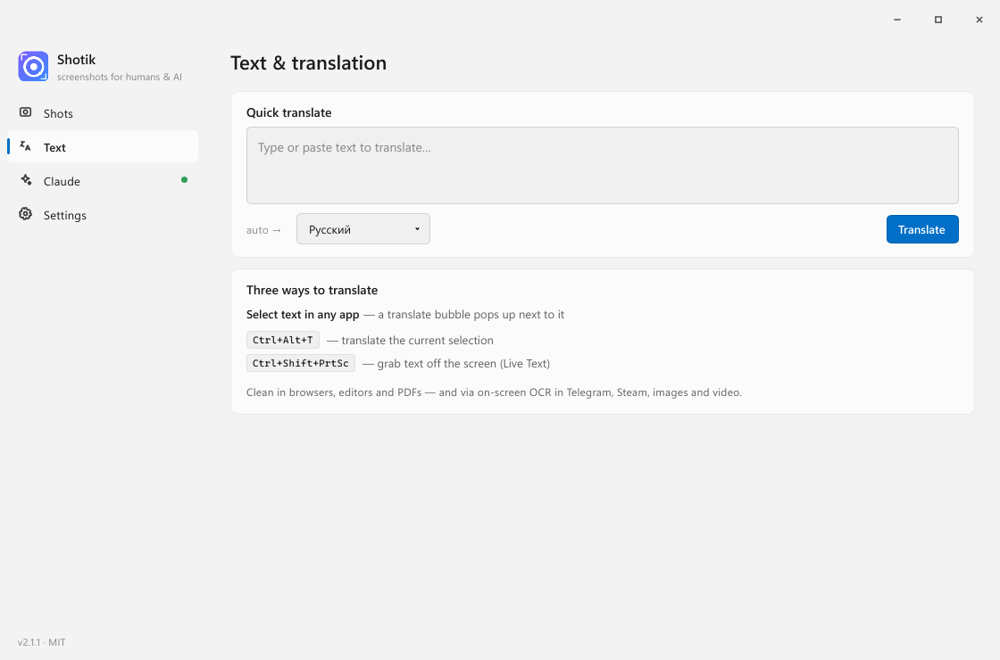

<p align="center">
  
</p>

<h1 align="center">Shotik</h1>

<p align="center">
  <b>Screenshots &amp; translation for humans and AI</b> · a beautiful open-source utility for Windows<br>
  with a built-in MCP server (Claude can see your screen) and translate-anything-on-screen
</p>

<p align="center">
  <a href="README.ru.md">Русская версия →</a>
</p>

<p align="center">
  <a href="https://github.com/gorka2354/shotik/releases/latest"></a>
  <a href="https://github.com/gorka2354/shotik/releases"></a>
  
  <a href="LICENSE"></a>
  
  
</p>

---

<p align="center">
  
</p>
<p align="center"><i>capture → annotate → OCR → one keypress to Claude · <a href="docs/promo.mp4">full-quality mp4</a></i></p>

<p align="center">
  
  
</p>
<p align="center"><i>native look — follows your system theme and Windows accent color · English &amp; Russian</i></p>

## Why Shotik?

Most screenshots today don't go to a photo album — they go to **Claude/ChatGPT in a console**, or to a chat, or you need the **text inside them**. Shotik is built for that world:

- **AI-first.** One keypress puts a shot straight into Claude Code, correctly. A built-in MCP server lets Claude *take* screenshots itself.
- **Translate anything you can see.** Select text in any app — or even text baked into a Telegram post, a Steam page, an image or a video — and get an instant translation. No copy-paste, no browser tab.
- **Speed without dialogs.** Capture → it's already in the clipboard, already on disk, ready to paste.
- **Lightweight & honest.** One native executable and nothing else. No telemetry, no account, no cloud. 3 MB of memory and no measurable CPU in the tray (see [Performance](#performance--privacy)).

Think ShareX capture + Flameshot annotations + a DeepL-style translator + Claude, in one small MIT app.

## New in 2.0: native

Shotik is now one small native executable, written in Rust: a 7 MB installer instead of 71 MB, 3 MB of
memory in the tray instead of 404 MB, and it is ready 32 ms after launch instead of 465 ms. Everything it did
before is still here, and an upgrade keeps your settings, history and shortcuts. Windows only for now.

## ✨ New in 1.0 — translate anything on screen

<p align="center">
  
  &nbsp;&nbsp;
  
</p>

**Just select text — a translate bubble pops up next to it; click, and the translation appears.** It works three ways, cleanest first:

1. **UI Automation** — in browsers, editors, PDFs, chat inputs: read instantly, *never touches your clipboard*.
2. **On-screen OCR** — in apps that draw their own text (**Telegram posts, Steam**, images, video frames): Shotik finds the selection highlight and reads the pixels you selected. Still no clipboard.
3. **`Ctrl+Alt+T`** — a manual shortcut that translates the current selection anywhere.

Prefer typing? The new **Text** tab is a built-in translator — paste text, pick a language, done.

<p align="center">
  
</p>

Translation is **free out of the box** (no key) or via your own **DeepL** key. A genuine replacement for the DeepL desktop app — and it reaches text DeepL can't (custom-drawn apps, images, video).

## Features

### ✦ A clipboard that does what you expect
**Copy** puts the **picture** in the clipboard — paste into a messenger or an editor and you get the image, never a file path. The **Claude** action (`A` in the overlay) copies image **and** path together: `Ctrl+V` into Claude Code or a terminal pastes the path, into an image app — the picture.

### ✦ Built-in MCP server
Connect once:

```bash
claude mcp add shotik --transport http http://127.0.0.1:7464/mcp
```

and Claude gets these tools:

| Tool | What it does |
|---|---|
| `take_screenshot` | look at the screen right now (pass `display_id` to pick a monitor) |
| `capture_window` *(1.1)* | shoot **one window** by title or id — works even when it's covered by other windows or on another monitor |
| `list_windows` *(1.1)* | enumerate open windows: titles, apps, bounds, which display |
| `ask_user_to_select_region` | open the overlay so **you** point at the area |
| `get_last_screenshot` | grab your latest shot |
| `take_screenshot_region` | capture a rectangle anywhere on the **virtual desktop** — global coordinates, any monitor |
| `list_screenshots`, `list_displays` | history and monitors |
| `list_recordings`, `get_last_recording` *(1.3)* | find your **calls and screen recordings** by path (kind, duration, size) — to transcribe or analyze |

Say "look at my screen" — and Claude sees it. Say "look here" — and just draw a box with your mouse.
Say "show me the Zarya window" — and Claude reads that window's own surface, no matter what's on top of it.
Say "go through my last call" — and Claude gets the path to the .m4a you just recorded.

### ✦ Translate selected text — no screenshot *(1.0)*
Select text in **any** app and a translate bubble appears; click it for the translation. Reads the selection through Windows UI Automation (no clipboard) — and via on-screen OCR with **highlight detection** in Telegram, Steam, images and video. Toggle in **Settings → Text & translation**; `Ctrl+Alt+T` and the **Text** tab work too.

### ✦ Live Text — grab &amp; translate text from anything (`Ctrl+Shift+PrtSc`)
Select an area and the recognized words become **selectable, right on the frozen screen** — like macOS Live Text. Drag to grab words, `Enter` to copy, or hit **Translate**. Offline OCR (your Windows languages). Better than PowerToys Text Extractor — that one just dumps everything into the clipboard.

### ✦ Flameshot-style overlay with annotations
Freeze-frame, magnifier with a pixel-perfect HEX picker, boxes, arrows, pen, highlighter,
**pixelate your secrets**, text, numbered markers — all inside the overlay, before saving.
Hovering highlights the window under the cursor; click captures it (hold `Alt` to disable snapping,
`Shift`+click for the whole screen).

### ✦ Repeat last area (`Shift+PrtSc`)
Same region, fresh pixels, instant, no overlay. Perfect for iteration loops:
fix the CSS → `Shift+PrtSc` → `Ctrl+V` to Claude → "see it now?". Survives restarts.

### ✦ Screen recording → video or GIF (`Ctrl+Alt+PrtSc`)
Select a region (or a window, or the whole screen) and record it to **MP4** (H.264, hardware-encoded), with a floating
controls bar (timer, pause, stop) and a live red border. Then **export any recording to GIF** in one
click. Optional system-audio and microphone capture, 15–60 fps and a 3-2-1 countdown.

Enable **Microphone** in **Settings → Screen recording** and select an input device
(system default unless changed). Record your voice alone or mix it with system
audio into a single video audio track. The microphone is released when recording
stops; unavailable devices and permission failures produce a visible error.
GIF exports contain images only, without audio.

Recordings are saved with their length and a seek index, so the timeline works in any player —
Windows Media Player, VLC, a browser — even for hour-long files, without re-encoding.

### ✦ Audio recording — calls and voice notes (`Ctrl+Alt+Shift+R`)
Record **sound only**: the other side of a call (system audio) and your voice (microphone), mixed
into one **.m4a** (AAC) that plays on any phone or messenger — about 1 MB per minute instead of
gigabytes of video. No region to select: a small bar with a timer and a **live level meter per
input** sits above the taskbar, so an hour of silence is caught in the first seconds. Inputs are in
**Settings → Audio recording**. Ready for transcription as is: `ffmpeg -i call.m4a -ac 1 -ar 16000 call.wav`.
Ask the other participants before recording a call.

### ✦ PowerToys Command Palette / Win+S
The installer adds Start Menu commands that show up in PowerToys Command Palette and Windows search:
**Area Screenshot**, **Full Screen**, **Repeat Last Area**, **Translate Selection**, **Record Audio**.
CLI too: `Shotik.exe --capture region|full|repeat|text|record|audio|translate`.

### ✦ And the rest
- **Pin** a shot on top of every window exactly where you cut it (wheel = zoom, right-click = menu)
- **Color picker** — `C` in the overlay copies the pixel HEX
- History gallery, toasts with previews, multi-monitor, HiDPI
- **Native look**: light/dark theme and accent color come from the OS and switch live
- **English &amp; Russian** UI (follows the system language, switchable in Settings)

## Hotkeys

| Action | Key |
|---|---|
| Capture area | `PrtSc` |
| Full screen (monitor under cursor) | `Ctrl+PrtSc` |
| Repeat last area | `Shift+PrtSc` |
| Extract text (Live Text) | `Ctrl+Shift+PrtSc` |
| Record region → video / GIF | `Ctrl+Alt+PrtSc` |
| Record audio (call, voice note) | `Ctrl+Alt+Shift+R` |
| Translate selected text | `Ctrl+Alt+T` |

In the overlay: `Enter`/double-click — copy · `Ctrl+S` — save as · `P` — pin · `T` — OCR ·
`A` — copy for Claude · `F` — whole screen · `1..0` — tools · `[` `]` — stroke width ·
`Ctrl+Z` — undo · arrows — nudge selection · `Esc` — cancel.

## Install

**Prebuilt:** [Releases](https://github.com/gorka2354/shotik/releases) →
`Shotik-Setup-x.x.x.exe` (installer with shortcuts) or `Shotik-x.x.x-portable.exe` (single file, no install).

**From source** (Rust 1.85 or newer):

```bash
git clone https://github.com/gorka2354/shotik && cd shotik
cargo build --release -p shotik
target/release/shotik.exe
```

Windows 10 (2004 or newer) and Windows 11. The app lives in the tray; quit via the tray menu.
Upgrading from an Electron version in place keeps your settings, history, autostart and shortcuts.

**macOS:** 2.0 is Windows-only for now. The last macOS build is the `.dmg` in
[v1.3.1](https://github.com/gorka2354/shotik/releases/tag/v1.3.1).

## Performance &amp; privacy

Shotik is meant to disappear into the tray and cost nothing while it's there. Version 2.0 is a native
Rust binary; the table compares it with the last Electron build, on one machine, with one script
([bench/run.js](bench/run.js)). More in [docs/PERF.md](docs/PERF.md).

| | Electron 1.3.0 | Electron 1.3.1 | Rust 2.0 |
|---|---:|---:|---:|
| Installer | 71 MB | 71 MB | 7 MB |
| Installed size | 269 MB | 269 MB | 27 MB |
| Startup to ready | 662 ms | 465 ms | 32 ms |
| Processes in the tray | 6 | 6 | 1 |
| Memory in the tray | 464 MB | 404 MB | 3 MB |
| CPU in the tray | 13 ms/s | 2 ms/s | 0 ms/s |
| Overlay shown | 753 ms | 6 460 ms | 82 ms |
| Memory with overlays open | 1 075 MB | 6 163 MB | 140 MB |
| Memory after closing them | 706 MB | 6 072 MB | 6 MB |
| `take_screenshot` | 1 677 ms | 3 804 ms | 191 ms |
| `list_windows` | 586 ms | 1 211 ms | 27 ms |
| `capture_window` | 999 ms | 1 714 ms | 31 ms |
| OCR of a selection | 685 ms | 698 ms | 49 ms |
| Video: start | 2 507 ms | 11 591 ms | 368 ms |
| Video: CPU | 871 ms/s | 617 ms/s | 46 ms/s |
| Video: peak memory | 1 514 MB | 6 782 MB | 113 MB |
| GIF export | 12 745 ms | 12 535 ms | 1 392 ms |
| Audio: start | 708 ms | 644 ms | 192 ms |
| Audio: CPU | 43 ms/s | 37 ms/s | 25 ms/s |

1.3.0 was measured with a game running, 1.3.1 and 2.0 on an idle machine, one after the other. 1.3.1 gave up its warm capture timer to fix a handle leak, which is why it captures slower than 1.3.0. Medians on a Ryzen 9 7950X3D with three monitors, one of them 4K at 150%, in ghost mode: on the real desktop a Rust overlay appears about 150 ms after the key press.

- **No telemetry, no account.** Two things reach the network: the translation call you trigger (free service or your DeepL key), and a once-a-day look at GitHub for a newer version, which you can turn off in Settings. Screenshots stay on your disk.
- **Updates in one click, and only on your click.** Updates are signed with a key that is not on GitHub, so taking over the repository is not enough to reach your machine. Details: [docs/rust/UPDATES.md](docs/rust/UPDATES.md).
- **One executable, no runtime.** The overlay stays out of memory until you need it: after you close it, the app is back to a few megabytes.
- **The select-to-translate watcher** runs inside the app and uses Windows UI Automation to read *whether* text is selected. It never logs keystrokes and never touches the clipboard. It runs **only** while "Translate bubble on selection" is on, and you can turn it off in Settings.

## For contributors: quality &amp; ghost mode

Tests never touch your desktop: windows are placed off-screen, the desktop is replaced by a fixture,
global hotkeys aren't registered, and everything is driven over HTTP `/test/*` endpoints.

```bash
cargo test --workspace            # unit and integration tests of every crate
cargo build --release -p shotik
npm test                          # contract tests over HTTP against the built binary (needs Node.js and ffmpeg)
node bench/run.js --impl rust --exe target/release/shotik.exe --label mine   # the numbers above
```

The suite covers the parts that are easy to get subtly wrong: OCR faithfulness (small text is upscaled;
Latin vs Cyrillic engines are disambiguated), selection-highlight detection, popup dismiss races, real
encoded recordings decoded and measured, and the translate flow end-to-end. See [AGENTS.md](AGENTS.md)
for the rules and [docs/rust/](docs/rust/ARCHITECTURE.md) for the design.

## Architecture

```
crates/
  shotik-core/      pure logic and ports: settings, history, translation, OCR selection, i18n
  shotik-win/       Windows adapters: capture, OCR (WinRT), UI Automation, hotkeys, tray, clipboard
  shotik-recorder/  screen and audio recording: Graphics Capture, Media Foundation, WASAPI
  shotik-mcp/       the MCP server
  shotik-ui/        windows in Slint: overlay, main window, toast, pin, translate popup, recording bar
  shotik-app/       the application: triggers, overlay results, selection flow, tray menu
  shotik/           the binary, wires everything together
```

## License

MIT. The Electron version it replaced stays readable at tag
[`electron-final`](https://github.com/gorka2354/shotik/tree/electron-final).

The windows are drawn with [Slint](https://slint.dev), used under its royalty-free license.

<a href="https://slint.dev"></a>
