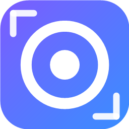
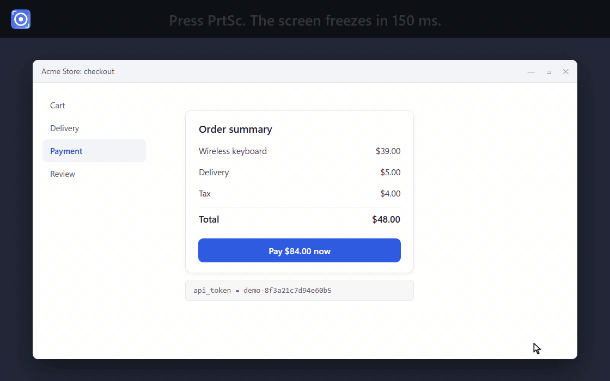
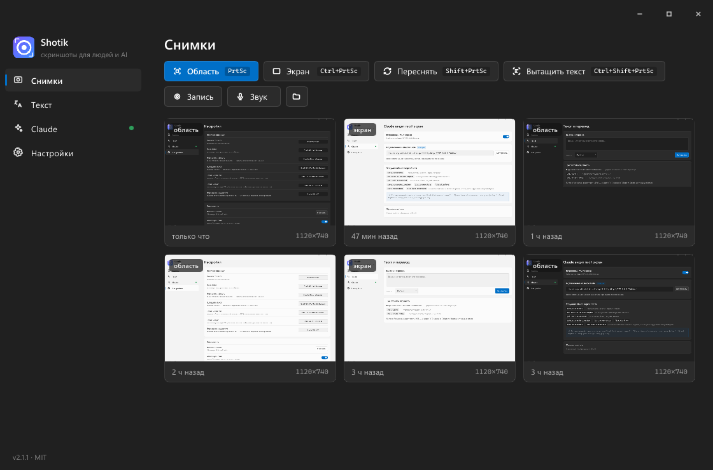
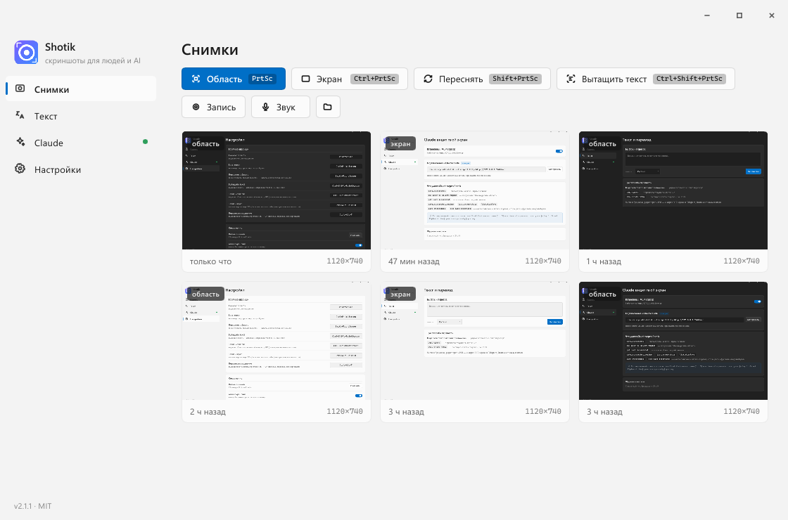
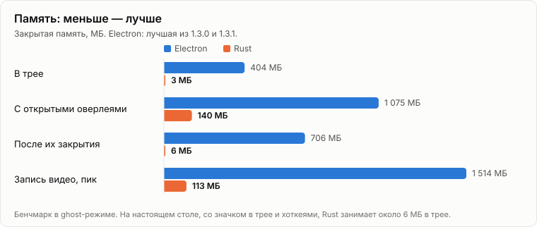
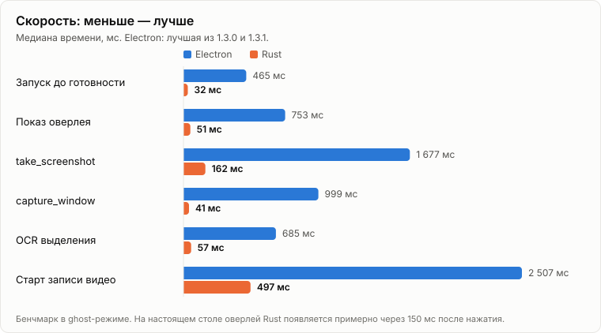
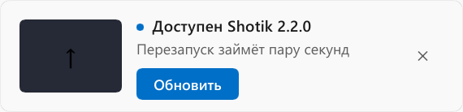
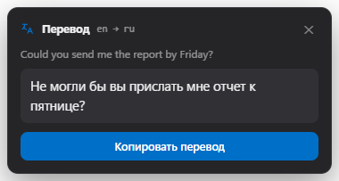
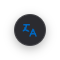
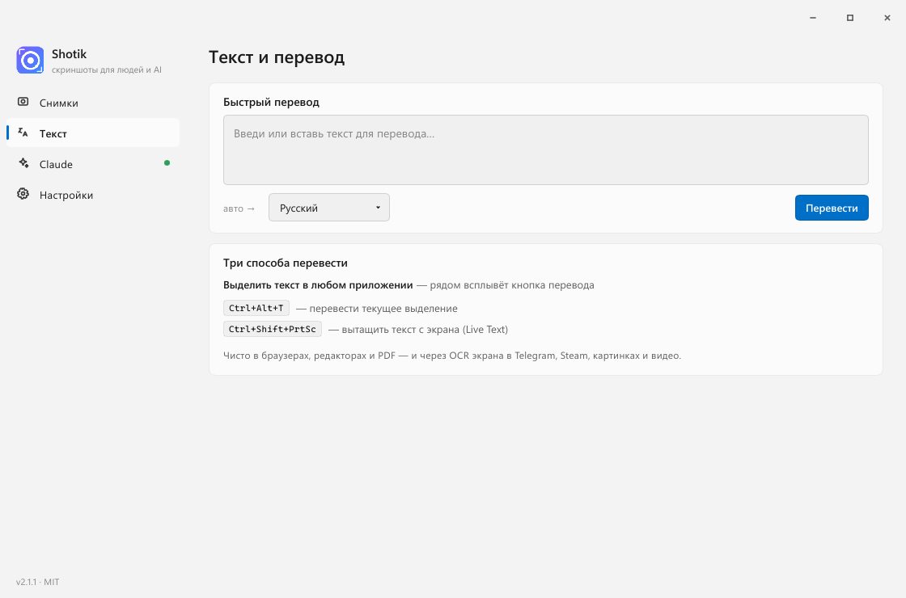

<p align="center">
  
</p>

<h1 align="center">Shotik</h1>

<p align="center">
  <b>Скриншоты и перевод для людей и AI</b> · красивая open-source утилита для Windows<br>
  со встроенным MCP-сервером (Claude видит твой экран) и переводом чего угодно на экране
</p>

<p align="center">
  <a href="README.md">English version →</a>
</p>

<p align="center">
  <a href="https://github.com/gorka2354/shotik/releases/latest"></a>
  <a href="https://github.com/gorka2354/shotik/releases"></a>
  
  <a href="LICENSE"></a>
  
  
</p>

---

<p align="center">
  
</p>
<p align="center"><i>захват → аннотации → OCR → одна клавиша до Claude · <a href="docs/promo.mp4">mp4 в полном качестве</a></i></p>

<p align="center">
  
  
</p>
<p align="center"><i>родной вид — тема и акцентный цвет из системы · русский и английский</i></p>

## Зачем Shotik?

Скриншоты сегодня чаще идут не в фотоальбом, а **в Claude/ChatGPT в консоль**, или в чат, или тебе нужен **текст внутри них**. Shotik сделан именно для этого:

- **AI-first.** Одна клавиша кладёт снимок прямо в Claude Code — правильно. Встроенный MCP-сервер позволяет Claude *самому* делать скриншоты.
- **Перевод всего, что видишь.** Выдели текст в любом приложении — или даже текст, вшитый в пост Telegram, страницу Steam, картинку или кадр видео — и получи мгновенный перевод. Без копипаста и вкладки браузера.
- **Скорость без диалогов.** Снял → уже в буфере, уже на диске, уже можно вставлять.
- **Лёгкий и честный.** Один нативный исполняемый файл, и всё. Ни телеметрии, ни аккаунта, ни облака. Около 6 МБ памяти и незаметный CPU в трее ([Electron → Rust](#electron--rust)).

По сути — ShareX-захват + аннотации Flameshot + переводчик уровня DeepL + Claude в одном маленьком MIT-приложении.

## Electron → Rust

Shotik начинался как приложение на Electron. В 2.0 он переписан с нуля на Rust: все возможности остались, настройки и история читаются те же, а ставится поверх старой версии.

| | Electron 1.3.1 | Rust 2.1 |
|---|---:|---:|
| Установщик | 71 МБ | **7 МБ** |
| На диске | 269 МБ, 80 файлов | **28 МБ, 3 файла** |
| Процессов в трее | 6 | **1** |
| Потоков в трее | 261 | **10** |
| Память в трее | 288 МБ | **5,8 МБ** |

Обе версии простаивают в трее в один момент, закрытая память каждого процесса:

```text
Electron 1.3.1                            Rust 2.1.1
  main          67 МБ    47 потоков         main     5,8 МБ    10 потоков
  GPU          100 МБ   120 потоков
  utility       69 МБ    53 потока
  renderer      26 МБ    12 потоков
  utility       14 МБ    20 потоков
  utility       12 МБ     9 потоков

  6 процессов  288 МБ   261 поток           1 процесс  5,8 МБ  10 потоков
```

<p align="center">
  <picture>
    <source media="(prefers-color-scheme: dark)" srcset="docs/charts/memory-ru-dark.svg">
    
  </picture>
</p>
<p align="center">
  <picture>
    <source media="(prefers-color-scheme: dark)" srcset="docs/charts/speed-ru-dark.svg">
    
  </picture>
</p>

Почему у памяти не одна цифра, отчего Electron был таким тяжёлым, что стало хуже и как это мерилось: **[полное сравнение](docs/ELECTRON-VS-RUST.ru.md)**.

## Новое в 2.1: обновление в один клик

<p align="center">
  
</p>

Shotik сообщает о новой версии и ставит её по клику за несколько секунд, сохраняя настройки и историю. Он ждёт, пока идёт запись, молчит во время полноэкранной игры и проверяет подпись, прежде чем что-либо запустить. [Как это устроено](docs/rust/UPDATES.md).

## ✨ Перевод чего угодно на экране

<p align="center">
  
  &nbsp;&nbsp;
  
</p>

**Просто выдели текст — рядом всплывёт кнопка перевода; клик — и появляется перевод.** Работает тремя способами, от самого чистого:

1. **UI Automation** — в браузерах, редакторах, PDF, полях ввода: читает мгновенно, *буфер обмена не трогается*.
2. **OCR экрана** — в приложениях, которые рисуют текст сами (**посты Telegram, Steam**, картинки, кадры видео): Shotik находит подсветку выделения и распознаёт ровно те пиксели, что ты выделил. И тоже без буфера.
3. **`Ctrl+Alt+T`** — ручное сочетание, переводит текущее выделение где угодно.

Любишь печатать? Вкладка **Текст** — встроенный переводчик: вставил текст, выбрал язык, готово.

<p align="center">
  
</p>

Перевод работает **бесплатно из коробки** (без ключа) или по твоему ключу **DeepL**. Настоящая замена десктопному приложению DeepL — и достаёт текст, который DeepL не может (custom-drawn приложения, картинки, видео).

## Возможности

### ✦ Буфер обмена, который делает то, что ждёшь
**Копировать** кладёт в буфер **картинку**: вставь в мессенджер или редактор, и получишь изображение, а не путь к файлу. Действие **Claude** (`A` в оверлее) кладёт картинку **и** путь вместе: `Ctrl+V` в Claude Code или терминал вставит путь, в графический редактор — картинку.

### ✦ Встроенный MCP-сервер
Подключи один раз:

```bash
claude mcp add shotik --transport http http://127.0.0.1:7464/mcp
```

и Claude получает инструменты:

| Инструмент | Что делает |
|---|---|
| `take_screenshot` | посмотреть на экран прямо сейчас (`display_id` выбирает монитор) |
| `capture_window` | снять **одно окно** по заголовку или id, даже если оно перекрыто другими или на другом мониторе |
| `list_windows` | список открытых окон: заголовки, приложения, границы, монитор |
| `ask_user_to_select_region` | открыть оверлей, чтобы **ты** показал область |
| `get_last_screenshot` | взять последний снимок |
| `take_screenshot_region` | снять прямоугольник где угодно на **виртуальном рабочем столе**: глобальные координаты, любой монитор |
| `list_screenshots`, `list_displays` | история и мониторы |
| `list_recordings`, `get_last_recording` | найти **созвоны и записи экрана** по пути (тип, длительность, размер), чтобы расшифровать или разобрать |

Скажи «посмотри на экран» — и Claude видит его. «Посмотри сюда» — просто нарисуй рамку мышкой.
«Покажи окно Зари» — и Claude читает поверхность самого окна, что бы ни было поверх него.
«Разбери последний созвон» — и Claude получит путь к только что записанному .m4a.

### ✦ Перевод выделенного текста — без скриншота
Выдели текст в **любом** приложении — рядом появится кнопка перевода; клик — перевод. Читает выделение
через Windows UI Automation (без буфера) — и через OCR экрана с **детектом подсветки** в Telegram, Steam,
картинках и видео. Тумблер в **«Настройки → Текст и перевод»**; `Ctrl+Alt+T` и вкладка **Текст** тоже работают.

### ✦ Live Text — вытащи и переведи текст откуда угодно (`Ctrl+Shift+PrtSc`)
Выдели область — и распознанные слова становятся **выделяемыми прямо на замороженном экране**, как в
macOS Live Text. Тяни мышкой, `Enter` — копировать, или жми **Перевести**. Офлайн-OCR (языки Windows).
Лучше PowerToys Text Extractor — тот просто вываливает всё в буфер.

### ✦ Оверлей с аннотациями (Flameshot-style)
Заморозка экрана, лупа с HEX-пипеткой, рамки, стрелки, перо, маркер, **пикселизация секретов**,
текст, нумерованные маркеры — всё в оверлее, до сохранения. Наведение подсвечивает окно под курсором;
клик снимает его (`Alt` — отключить привязку, `Shift`+клик — весь экран).

### ✦ Переснять область (`Shift+PrtSc`)
Та же область, свежие пиксели, мгновенно, без оверлея — идеально для итераций с Claude:
поправил CSS → `Shift+PrtSc` → `Ctrl+V` в Claude → «теперь видно?». Работает после перезапуска.

### ✦ Запись экрана → видео или GIF (`Ctrl+Alt+PrtSc`)
Выдели область (или окно, или весь экран) и запиши в **MP4** (H.264, аппаратное кодирование): плавающая панель (таймер, пауза, стоп)
и живая красная рамка. Затем **любую запись можно экспортировать в GIF** в один клик. Опционально:
системный звук, микрофон, 15–60 fps и отсчёт 3-2-1.

В **Настройки → Запись экрана** включите **Микрофон** и выберите устройство ввода
(по умолчанию — как в системе). Голос можно записывать отдельно или вместе с
системным звуком: оба источника сводятся в одну аудиодорожку видео. Микрофон
включается только на время записи; при отсутствии устройства или разрешения
Shotik показывает ошибку. Экспорт в GIF сохраняет только изображение, без звука.

Запись сохраняется с длительностью и индексом перемотки, поэтому ползунок работает в любом
плеере (Медиаплеер Windows, VLC, браузер) даже на часовых файлах, без перекодирования.

### ✦ Запись звука — созвоны и голосовые заметки (`Ctrl+Alt+Shift+R`)
Запись **только звука**: собеседники (системный звук) и ваш голос (микрофон) сводятся в один
**.m4a** (AAC), который откроется на любом телефоне и в мессенджере, — около 1 МБ в минуту вместо
гигабайтов видео. Область выделять не нужно: над панелью задач появляется маленькая панель с таймером
и **индикатором уровня для каждого входа**, так что час тишины виден в первые секунды. Источники —
в **Настройки → Запись звука**. Готово для расшифровки как есть: `ffmpeg -i call.m4a -ac 1 -ar 16000 call.wav`.
Перед записью созвона предупредите собеседников.

### ✦ PowerToys Command Palette / Win+S
Установщик добавляет команды в «Пуск», видимые в палитре команд PowerToys и поиске Windows:
**Снимок области**, **Весь экран**, **Переснять область**, **Перевести выделение**, **Запись звука**.
CLI тоже: `Shotik.exe --capture region|full|repeat|text|record|audio|translate`.

### ✦ И остальное
- **Pin** — прилепить снимок поверх всех окон точно там, где вырезал (колесо = зум, ПКМ = меню)
- **Пипетка** — `C` в оверлее копирует HEX цвета пикселя
- История с галереей, тосты с превью, мультимонитор, HiDPI
- **Родной вид**: светлая/тёмная тема и акцентный цвет из системы, на лету
- **Русский и английский** интерфейс (по языку системы, переключается в настройках)

## Горячие клавиши

| Действие | Клавиша |
|---|---|
| Снимок области | `PrtSc` |
| Весь экран (монитор под курсором) | `Ctrl+PrtSc` |
| Переснять последнюю область | `Shift+PrtSc` |
| Вытащить текст (Live Text) | `Ctrl+Shift+PrtSc` |
| Запись области → видео / GIF | `Ctrl+Alt+PrtSc` |
| Запись звука (созвон, заметка) | `Ctrl+Alt+Shift+R` |
| Перевести выделенный текст | `Ctrl+Alt+T` |

В оверлее: `Enter`/двойной клик — копировать · `Ctrl+S` — сохранить как · `P` — pin · `T` — OCR ·
`A` — для Claude · `F` — весь экран · `1..0` — инструменты · `[` `]` — толщина ·
`Ctrl+Z` — отмена · стрелки — сдвиг · `Esc` — выход.

## Установка

**Готовые сборки:** [Releases](https://github.com/gorka2354/shotik/releases) →
`Shotik-Setup-x.x.x.exe` (установщик, обновляется сам) или `Shotik-x.x.x-portable.exe` (один файл, без установки, кнопка обновления открывает страницу релиза).

**Из исходников** (CI собирает на Rust 1.97):

```bash
git clone https://github.com/gorka2354/shotik && cd shotik
cargo build --release -p shotik
target/release/shotik.exe
```

Windows 11. Windows 10 (2004 или новее) должна работать, сборка на неё рассчитана, но там ещё не запускалась.
Приложение живёт в трее; выход — через меню трея. Версии до 2.1 сами обновиться не могут: поставь новую поверх вручную,
настройки, история, автозапуск и ярлыки сохранятся.

**macOS:** с версии 2.0 Shotik пока только для Windows. Последняя сборка для macOS — `.dmg` в
[v1.3.1](https://github.com/gorka2354/shotik/releases/tag/v1.3.1).

## Производительность и приватность

Shotik должен исчезать в трее и ничего не стоить, пока он там. Все цифры в этом README получены одним скриптом,
[bench/run.js](bench/run.js), сырые результаты лежат в [bench/results](bench/results). Полная таблица — в [docs/PERF.md](docs/PERF.md).

- **Обновление в один клик и только по вашему клику.** Обновления подписаны ключом, которого нет на GitHub, так что захвата репозитория мало, чтобы добраться до вашего компьютера. Подробности: [docs/rust/UPDATES.md](docs/rust/UPDATES.md).
- **Ни телеметрии, ни аккаунта.** В сеть уходят две вещи: раз в сутки запрос к GitHub о новой версии, который можно выключить в настройках, и перевод, который вы сами запускаете (бесплатный сервис или ваш ключ DeepL). Скриншоты остаются на вашем диске.
- **Один файл, без рантайма.** Оверлей не занимает память, пока не нужен: после закрытия приложение возвращается к нескольким мегабайтам.
- **Watcher выделения** работает внутри приложения и через Windows UI Automation узнаёт только, *есть ли* выделение. Он не логирует клавиши и не трогает буфер обмена. Работает **только** пока включён «Пузырь перевода при выделении», и его можно выключить в настройках.

## Контрибьюторам: качество и ghost-режим

Тесты не касаются рабочего стола: окна за экраном, рабочий стол заменён фикстурой, глобальные хоткеи не
регистрируются, всё управляется по HTTP `/test/*`.

```bash
cargo test --workspace            # юнит- и интеграционные тесты всех крейтов
cargo build --release -p shotik
npm test                          # контрактные тесты по HTTP против собранного бинарника (нужны Node.js и ffmpeg)
node bench/run.js --impl rust --exe target/release/shotik.exe --label mine   # цифры из таблицы выше
node bench/charts.js              # перерисовывает графики из bench/results
SHOTIK_BIN=target/release/shotik.exe node docs/make-screenshots.js   # переснимает окна приложения в ghost-режиме
```

Набор покрывает то, что легко испортить незаметно: точность OCR (мелкий текст апскейлится; латиница и
кириллица разводятся), детект подсветки выделения, гонки скрытия попапа, настоящие записи, которые
декодируются и измеряются, весь флоу перевода. Правила — в [AGENTS.md](AGENTS.md), устройство — в
[docs/rust/](docs/rust/ARCHITECTURE.md).

## Архитектура

```
crates/
  shotik-core/      чистая логика и порты: настройки, история, перевод, выбор OCR, i18n
  shotik-win/       адаптеры Windows: захват, OCR (WinRT), UI Automation, хоткеи, трей, буфер обмена
  shotik-recorder/  запись экрана и звука: Graphics Capture, Media Foundation, WASAPI
  shotik-mcp/       MCP-сервер
  shotik-ui/        окна на Slint: оверлей, главное окно, тост, пин, попап перевода, панель записи
  shotik-app/       приложение: триггеры, результаты оверлея, флоу выделения, меню трея
  shotik/           бинарник, собирает всё вместе
```

## Лицензия

MIT. Electron-версия, которую он заменил, остаётся доступной по тегу
[`electron-final`](https://github.com/gorka2354/shotik/tree/electron-final).

Окна рисуются на [Slint](https://slint.dev), по его бесплатной лицензии (royalty-free).

<a href="https://slint.dev"></a>
