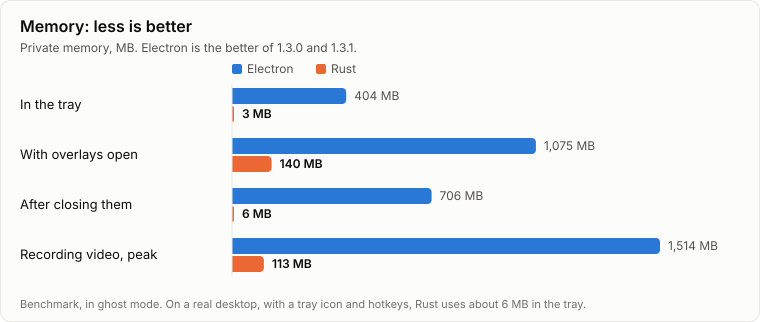
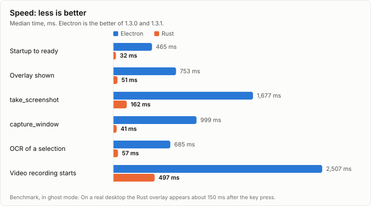

# From Electron to Rust

[Русская версия](ELECTRON-VS-RUST.ru.md)

Shotik 1.x was an Electron app: a screenshot tool carrying its own copy of Chromium. Version 2.0 is the same application written again from scratch in Rust. Every feature stayed, it reads the same settings and history, and it installs over the old version in place. The contract tests that passed against Electron run unchanged against the new binary.

Everything below was measured on one machine. The Electron code stays readable at tag [`electron-final`](https://github.com/gorka2354/shotik/tree/electron-final).

| | Electron 1.3.1 | Rust 2.1 | |
|---|---:|---:|---:|
| Installer | 71 MB | 7 MB | 10× smaller |
| On disk | 269 MB, 80 files | 28 MB, 3 files | 10× smaller |
| Processes in the tray | 6 | 1 | |
| Threads in the tray | 261 | 10 | 26× fewer |
| Memory in the tray | 288 MB | 5.8 MB | 50× less |

## Side by side, at the same moment

Private memory of each process, both idle in the tray:

```text
Electron 1.3.1                            Rust 2.1.1
  main          67 MB    47 threads         main     5.8 MB    10 threads
  GPU          100 MB   120 threads
  utility       69 MB    53 threads
  renderer      26 MB    12 threads
  utility       14 MB    20 threads
  utility       12 MB     9 threads

  6 processes  288 MB   261 threads         1 process  5.8 MB  10 threads
```

This comparison favors Electron. It ran in ghost mode on an empty profile, with no hotkeys and no selection watcher, and had taken no captures. Rust is the real installed copy, with its hotkeys, the selection watcher and a history of 500 shots.

## Memory

<picture>
  <source media="(prefers-color-scheme: dark)" srcset="charts/memory-en-dark.svg">
  
</picture>

Memory in the tray has three honest answers, depending on what is counted:

| What is counted | Electron | Rust |
|---|---:|---:|
| The benchmark: private memory, ghost mode for both, real capture turned on | 404 MB | 3 MB |
| Side by side above: private memory, Rust on the real desktop | 288 MB | 5.8 MB |
| Task Manager at the same moment: only what sits in RAM right now | 103 MB | 1.8 MB |

However you count, it is at least 50 times less. Task Manager shows the smallest numbers because Windows moves what an idle process does not touch out of RAM. Right after starting, before that happens, it shows about 5 MB for Rust.

## Speed

<picture>
  <source media="(prefers-color-scheme: dark)" srcset="charts/speed-en-dark.svg">
  
</picture>

On the real desktop, from the key press to the overlay on screen, Rust takes about 150 ms. Electron 1.3.1 took 3 to 6.5 seconds.

While recording video, CPU went from 617 ms per second to 44, because the video is encoded by the graphics card instead of in software by Chromium.

## Why Electron was so heavy

- **Chromium is a browser.** One tray icon cost a main process, a GPU process, a renderer and three utility processes, whatever the application did.
- **Capture went through the browser too.** `desktopCapturer.getSources` captures every screen on each call and starts its engine cold, and that was most of an overlay's time.
- **Keeping it warm leaked.** A timer took 350 ms off the overlay, but each call left two handles behind inside Chromium: 140,000 handles and 5 GB of memory after 16 days. 1.3.1 removed the timer to stop the leak, which is why it captures so much slower than 1.3.0.

Rust takes a frame with GDI `BitBlt` in tens of milliseconds and holds nothing between frames. [docs/PERF.md](PERF.md) has the details.

## What got worse, or went away

- **Video files are bigger:** 9 to 12 MB for a minute of the benchmark's still screen, against 6 MB. Hardware H.264 against software VP9: that is the price of the CPU saving above.
- **After the first video recording the process keeps about 100 MB** until it exits, with 42 threads and an NVENC session. On this driver, releasing a device that drove capture leaks, so it is never released. If OBS or ShadowPlay run out of NVENC sessions, restarting Shotik gives its session back.
- **macOS is gone for now.** The last macOS build is the `.dmg` in [v1.3.1](https://github.com/gorka2354/shotik/releases/tag/v1.3.1).

## What is not proven yet

- **Windows 10.** The build targets 2004 and newer, but it has not been run there.
- **Long runs.** The leak test ran for 30 minutes and 84 cycles of real capture: handles went from 324 to 309, memory from 3 to 7 MB, with no failures. The old leak took 16 days to show.

## How it was measured

One script, [bench/run.js](../bench/run.js), runs one scenario against every build: real capture, in ghost mode, so the desktop stays untouched. The raw results are in [bench/results](../bench/results), and the full table is in [docs/PERF.md](PERF.md). Medians, on a Ryzen 9 7950X3D with three monitors, one of them 4K at 150%.

The charts compare Rust with the better of Electron 1.3.0 and 1.3.1 on every row, so against Electron at its best. 1.3.0 was measured with a game running, 1.3.1 and 2.0 on an idle machine, 2.1 with a browser and messengers open.

```bash
node bench/run.js --impl rust --exe target/release/shotik.exe --label mine
node bench/compare.js bench/results/electron-1.3.1.json bench/results/mine.json
node bench/charts.js          # redraws the charts from bench/results
```
