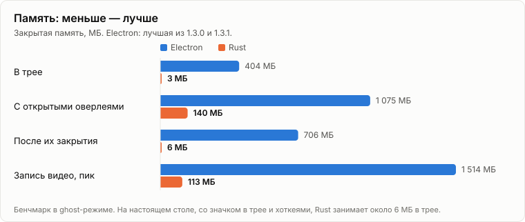
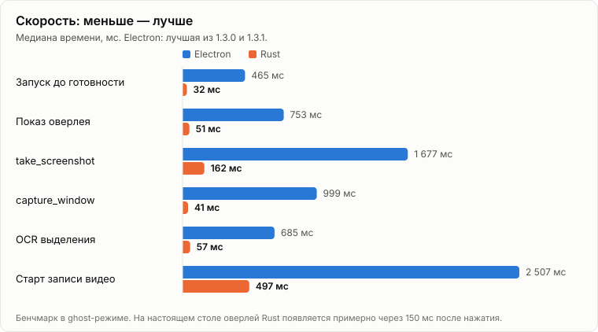

# С Electron на Rust

[English version](ELECTRON-VS-RUST.md)

Shotik 1.x был приложением на Electron: программа для скриншотов, которая носила с собой собственную копию Chromium. Версия 2.0 — то же приложение, написанное заново с нуля на Rust. Все возможности остались, настройки и история читаются те же, а ставится поверх старой версии. Контрактные тесты, которые проходили на Electron, без изменений идут на новом бинарнике.

Всё ниже измерено на одной машине. Код Electron остаётся доступным по тегу [`electron-final`](https://github.com/gorka2354/shotik/tree/electron-final).

| | Electron 1.3.1 | Rust 2.1 | |
|---|---:|---:|---:|
| Установщик | 71 МБ | 7 МБ | в 10 раз меньше |
| На диске | 269 МБ, 80 файлов | 28 МБ, 3 файла | в 10 раз меньше |
| Процессов в трее | 6 | 1 | |
| Потоков в трее | 261 | 10 | в 26 раз меньше |
| Память в трее | 288 МБ | 5,8 МБ | в 50 раз меньше |

## Рядом, в один момент

Закрытая память каждого процесса, обе версии простаивают в трее:

```text
Electron 1.3.1                            Rust 2.1.1
  main          67 МБ    47 потоков         main     5,8 МБ    10 потоков
  GPU          100 МБ   120 потоков
  utility       69 МБ    53 потока
  renderer      26 МБ    12 потоков
  utility       14 МБ    20 потоков
  utility       12 МБ     9 потоков

  6 процессов  288 МБ   261 поток           1 процесс  5,8 МБ  10 потоков
```

В этом сравнении преимущество у Electron. Он работал в ghost-режиме на пустом профиле, без хоткеев и наблюдения за выделением, и ещё ничего не снимал. Rust — настоящая установленная копия: с хоткеями, наблюдением за выделением и историей на 500 снимков.

## Память

<picture>
  <source media="(prefers-color-scheme: dark)" srcset="charts/memory-ru-dark.svg">
  
</picture>

У памяти в трее три честных ответа, смотря что считать:

| Что считается | Electron | Rust |
|---|---:|---:|
| Бенчмарк: закрытая память, у обеих ghost-режим, настоящий захват включён | 404 МБ | 3 МБ |
| Сравнение выше: закрытая память, Rust на настоящем столе | 288 МБ | 5,8 МБ |
| Диспетчер задач в тот же момент: только то, что лежит в оперативке прямо сейчас | 103 МБ | 1,8 МБ |

Как ни считай, разница не меньше чем в 50 раз. В диспетчере задач цифры самые маленькие, потому что Windows выгружает из оперативки то, чего простаивающий процесс не касается. Сразу после запуска, пока этого не случилось, он показывает для Rust около 5 МБ.

## Скорость

<picture>
  <source media="(prefers-color-scheme: dark)" srcset="charts/speed-ru-dark.svg">
  
</picture>

На настоящем столе от нажатия клавиши до оверлея на экране у Rust проходит около 150 мс. У Electron 1.3.1 — от 3 до 6,5 секунды.

При записи видео нагрузка на процессор упала с 617 мс в секунду до 44: видео теперь кодирует видеокарта, а не Chromium программно.

## Почему Electron был таким тяжёлым

- **Chromium — это браузер.** Один значок в трее стоил главного процесса, процесса GPU, рендерера и трёх служебных, что бы приложение ни делало.
- **Захват тоже шёл через браузер.** `desktopCapturer.getSources` при каждом вызове снимает все экраны и запускает движок с холодного старта, и на это уходила большая часть времени оверлея.
- **Прогрев утекал.** Таймер срезал 350 мс с оверлея, но каждый вызов оставлял два дескриптора внутри Chromium: 140 000 дескрипторов и 5 ГБ памяти за 16 дней. В 1.3.1 таймер убрали, чтобы остановить утечку, поэтому она снимает намного медленнее 1.3.0.

Rust берёт кадр через GDI `BitBlt` за десятки миллисекунд и ничего не держит между кадрами. Подробности в [docs/PERF.md](PERF.md).

## Что стало хуже или пропало

- **Видеофайлы больше:** 9–12 МБ на минуту неподвижного экрана из бенчмарка против 6 МБ. Аппаратный H.264 против программного VP9: это цена экономии процессора, о которой выше.
- **После первой видеозаписи процесс держит около 100 МБ** до выхода, вместе с 42 потоками и сессией NVENC. На этом драйвере освобождение устройства, которое вело захват, даёт утечку, поэтому оно не освобождается никогда. Если OBS или ShadowPlay упрутся в лимит сессий NVENC, перезапуск Shotik вернёт его сессию.
- **macOS пока нет.** Последняя сборка для macOS — `.dmg` в [v1.3.1](https://github.com/gorka2354/shotik/releases/tag/v1.3.1).

## Что пока не доказано

- **Windows 10.** Сборка рассчитана на 2004 и новее, но там ещё не запускалась.
- **Долгая работа.** Тест на утечки шёл 30 минут, 84 цикла настоящего захвата: дескрипторы 324 → 309, память 3 → 7 МБ, сбоев нет. Старая утечка проявлялась за 16 дней.

## Как измерялось

Один скрипт, [bench/run.js](../bench/run.js), гоняет один сценарий на каждой сборке: настоящий захват, в ghost-режиме, рабочий стол не затрагивается. Сырые результаты лежат в [bench/results](../bench/results), полная таблица — в [docs/PERF.md](PERF.md). Медианы, на Ryzen 9 7950X3D с тремя мониторами, один из них 4K при 150 %.

Графики сравнивают Rust с лучшей из Electron 1.3.0 и 1.3.1 по каждой строке, то есть с Electron в его лучшем виде. 1.3.0 мерился при запущенной игре, 1.3.1 и 2.0 на свободной машине, 2.1 с открытыми браузером и мессенджерами.

```bash
node bench/run.js --impl rust --exe target/release/shotik.exe --label mine
node bench/compare.js bench/results/electron-1.3.1.json bench/results/mine.json
node bench/charts.js          # перерисовывает графики из bench/results
```
